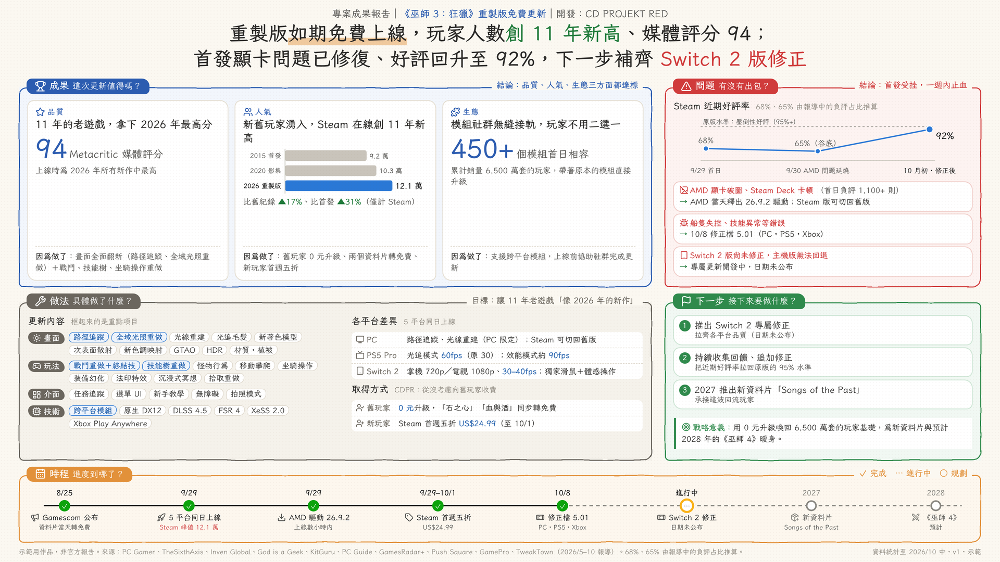
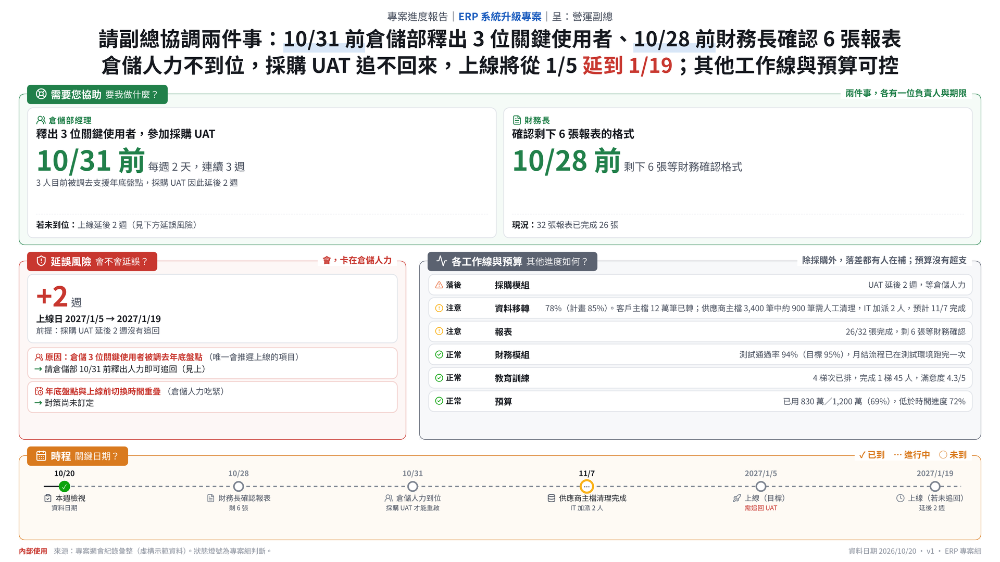

# one-page-report

An AI skill that turns project or business material into a **one-page visual report** a busy
reader understands in ten seconds. 16:9, Chinese and English versions, PNG / PDF / HTML / PPTX.

一個把專案或業務資料做成**十秒看懂的一頁式報告**的 AI skill。16:9，中英兩版，輸出 PNG、PDF、HTML、PPT。

| Results (hand-drawn) | Progress (business) |
|---|---|
|  |  |

## What it does

1. **Interviews you first**, one question at a time, until it knows what you want, what must
   not be touched and how you judge success. Then it restates the requirements for your OK.
2. Picks a **skeleton** for the report type: results, progress, proposal, post-mortem, comparison.
3. **Distils a storyline**: one-sentence conclusion, 2–4 reasons, evidence under each. You
   confirm it before any design.
4. Chooses **charts, colours and icons** by rule (one highlight, colour-blind checked, icons
   only where they help sorting).
5. Lays out **zones by the reader's questions**, builds both languages, renders all formats.
6. **Self-reviews**: logic, data traceability, zh/en number match, overlap and overflow,
   "AI feel", and a stranger test by a reviewer who never saw the material.

## Install

**Claude Code**: copy `one-page-report/` to `~/.claude/skills/one-page-report/`.

**claude.ai / Claude desktop**: zip the `one-page-report/` folder (the zip's top folder must be
`one-page-report`, with `SKILL.md` inside), then Customize → Skills → + → upload.
Turn on code execution.

**ChatGPT, Copilot, Gemini, other AI**: see `one-page-report/portable/README-zh-TW.md`.

## Use

> 我要做一份專案成果報告給部門主管，資料如下……

No packages to install. Rendering uses Playwright or any Chrome/Edge already on the machine;
without a browser it delivers the HTML for you to print to PDF.

## Folder

| Path | What |
|---|---|
| `one-page-report/SKILL.md` | The skill (start here) |
| `one-page-report/references/` | Method: report types, storyline, charts & colour, layout, icons, review, spec format, brand style |
| `one-page-report/scripts/` | `build_report.py`, `render.py`, `build_pptx.py`, `review.py`, `check_colors.py`, `extract_brand.py` |
| `one-page-report/assets/` | Styles (hand-drawn, business, brand template), 163 Lucide icons, fonts |
| `one-page-report/examples/` | Complete specs: results, progress, proposal (zh + en) |
| `one-page-report/portable/` | One-file instructions for other AI tools |
| `one-page-report/licenses/` | Third-party licences and credits |

## Licence

MIT (`LICENSE`). Bundled third-party parts keep their own licences: Lucide icons (ISC), LXGW
WenKai TC, Inter and Patrick Hand fonts (SIL OFL 1.1). Methods adapted from
enterprise-ai-skills by Sruthi Reddy (MIT). See `one-page-report/licenses/CREDITS.md`.

The Witcher 3 sample uses public news reports for demonstration; it is not an official
CD PROJEKT RED report. Other samples use fictional data.
