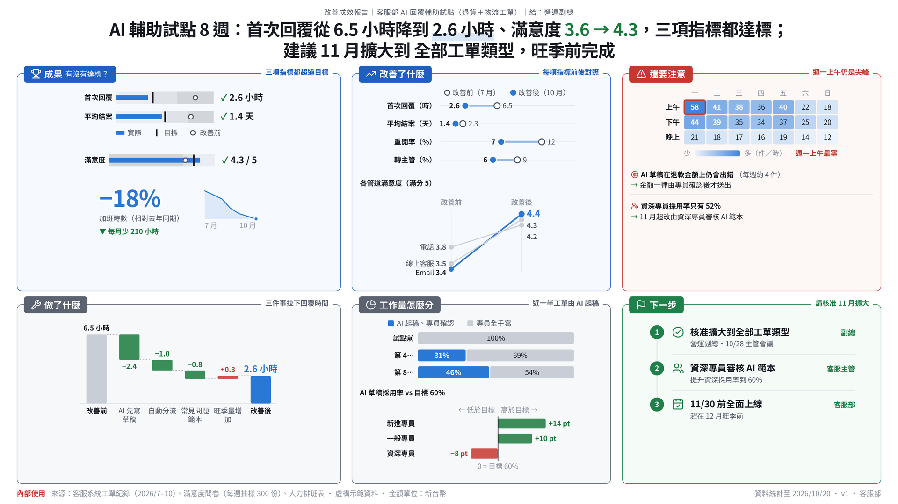
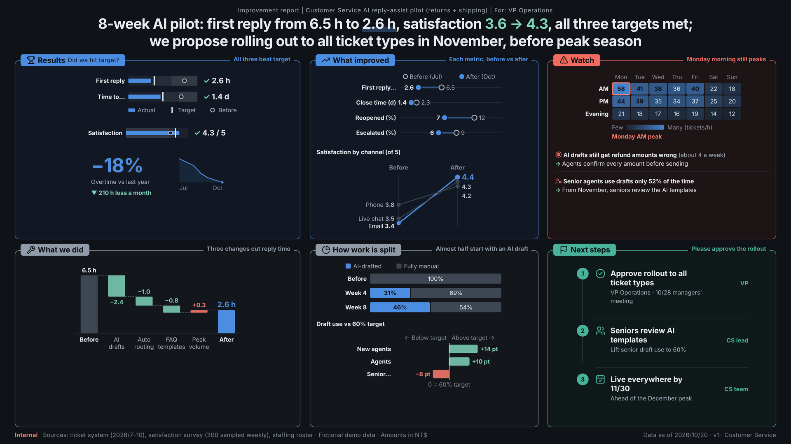
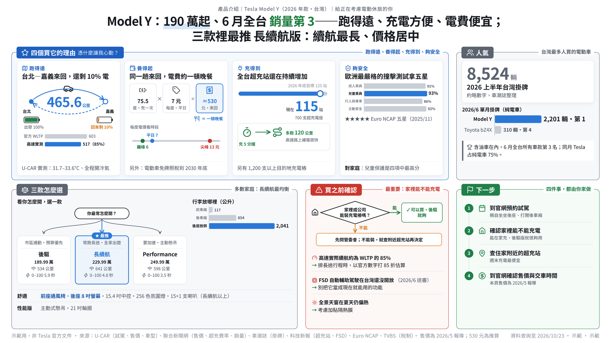

# one-page-report

An AI skill that turns project or business material into a **one-page visual report** a busy
reader understands in ten seconds. 16:9, Chinese and English, light or dark, PNG / PDF / HTML / PPTX.
Pictures carry the logic; text supports them.

一個把專案或業務資料做成**十秒看懂的一頁式報告**的 AI skill。16:9，中英兩版，淺色或深色，
輸出 PNG、PDF、HTML、PPT。用圖講邏輯，文字做輔助。

| Improvement report (business, light) | Same report (English, dark) |
|---|---|
|  |  |
| **Results (hand-drawn)** | **Product explainer (business)** |
|  |  |

All 20 diagram and chart types: [docs/samples/chart-gallery.png](docs/samples/chart-gallery.png) ·
Screenshot with numbered marks: [docs/samples/screenshot-marks.png](docs/samples/screenshot-marks.png)

## What it does

1. **Interviews you first**, one question at a time (each with a suggested answer), until it knows
   what you want, what must not be touched and how you judge success. Then it restates the
   requirements for your OK. It also asks once whether this is for **home or company** use:
   at the company it only uses the intranet and company-allowed sites, with a fallback when a site
   is blocked.
2. **Reads your material**: meeting notes, Excel / CSV data (numbers computed in code, every
   worked-out figure recorded), existing decks and documents, a spoken summary, screenshots.
3. Picks a **skeleton**: results, improvement, progress, proposal, post-mortem, comparison.
4. **Distils a storyline**: one-sentence conclusion, a background zone that says what is going on,
   what changed and what must be decided, 2–4 reasons, evidence under each. You confirm it before
   any design.
5. Names each zone's **shape of information** and draws it: route, calculation, choice, yes/no,
   before → after, steps — and report charts for results and improvement: KPI tile with sparkline,
   bullet (actual vs target vs before), dumbbell, slope, waterfall, variance, stacked, heatmap.
6. Asks **style** (hand-drawn, business, company template, or the subject's own look), **light or
   dark**, and **whether to use images** at all — you decide; images that do not suit the theme are
   replaced or dropped, never forced.
7. Lays out **zones by the reader's questions** with exactly 4 font sizes, builds both languages,
   renders all formats.
   Design options are offered with a recommendation and tried first: heading styles, frames,
   bento layout, arrows between zones, a summary strip, a speech-bubble aside.
8. **Self-reviews**: logic, every number traced to your files (.csv .xlsx .pptx .docx read directly)
   and every calculation recomputed, totals that must add up, zh/en match, overlap and overflow,
   rendered font sizes, missing icons, numbers shown twice, empty "not given" cells, "AI feel",
   and a stranger test. The delivery ends with a **step log** (done / skipped / not verified), so a
   skipped step is never reported as done.

Report types, charts and layouts are tools, not templates: the same rules work for a project, a
purchase, a plan or an incident, and exceptions are agreed in the interview.

## Good for / not for

**Good for**: project results, improvement reports, progress updates, proposals, post-mortems,
option comparisons, product explainers — any page where a busy reader needs the conclusion and
the decision at a glance.

**Not for**: content that needs several pages, dashboards that refresh automatically, analysis that
has no conclusion yet, A4 portrait, languages other than Chinese and English. In the editable PPT,
diagrams and photos are pictures (text boxes and charts stay editable).

## Install

**Claude Code**: copy `one-page-report/` to `~/.claude/skills/one-page-report/`.

**claude.ai / Claude desktop**: zip the `one-page-report/` folder (the zip's top folder must be
`one-page-report`, with `SKILL.md` inside), then Customize → Skills → + → upload.
Turn on code execution.

**ChatGPT, Copilot, Gemini, other AI**: see `one-page-report/portable/README-zh-TW.md`.

## Use

> 我要做一份改善成效報告給營運副總，資料是附上的 Excel 和會議記錄……

No packages to install. Rendering uses Playwright or any Chrome/Edge already on the machine;
without a browser it delivers the HTML for you to print to PDF. The HTML is self-contained and
opens offline.

## Folder

| Path | What |
|---|---|
| `one-page-report/SKILL.md` | The skill (start here) |
| `one-page-report/references/` | Method: report types, storyline, inputs, diagrams & report charts, charts & colour, imagery & themes, layout, design options, icons, review, spec format, brand style |
| `one-page-report/scripts/` | `build_report.py`, `diagrams.py`, `render.py`, `build_pptx.py`, `review.py`, `check_colors.py`, `extract_brand.py` |
| `one-page-report/assets/` | Styles (hand-drawn, business, brand template — each light and dark), 173 Lucide icons, fonts |
| `one-page-report/examples/` | Complete specs (zh + en): improvement, results, product explainer, progress, proposal |
| `one-page-report/portable/` | One-file instructions for other AI tools |
| `one-page-report/licenses/` | Third-party licences and credits |
| `one-page-report/upstream-sources.json` | Versions of the adapted sources last reviewed; skill-update-check reports when they change |

## Licence

MIT (`LICENSE`). Bundled third-party parts keep their own licences: Lucide icons (ISC), LXGW
WenKai TC, Inter and Patrick Hand fonts (SIL OFL 1.1). Methods adapted from enterprise-ai-skills
by Sruthi Reddy (MIT). Ideas (no code) from the dataviz skill, the IBCS reporting standard,
AntV Infographic, answer-me-with-html and emilkowalski/skills. See `one-page-report/licenses/CREDITS.md`.

The Witcher 3 and Model Y samples use public reports for demonstration; they are not official
CD PROJEKT RED or Tesla documents. No brand images are bundled. Other samples use fictional data.
